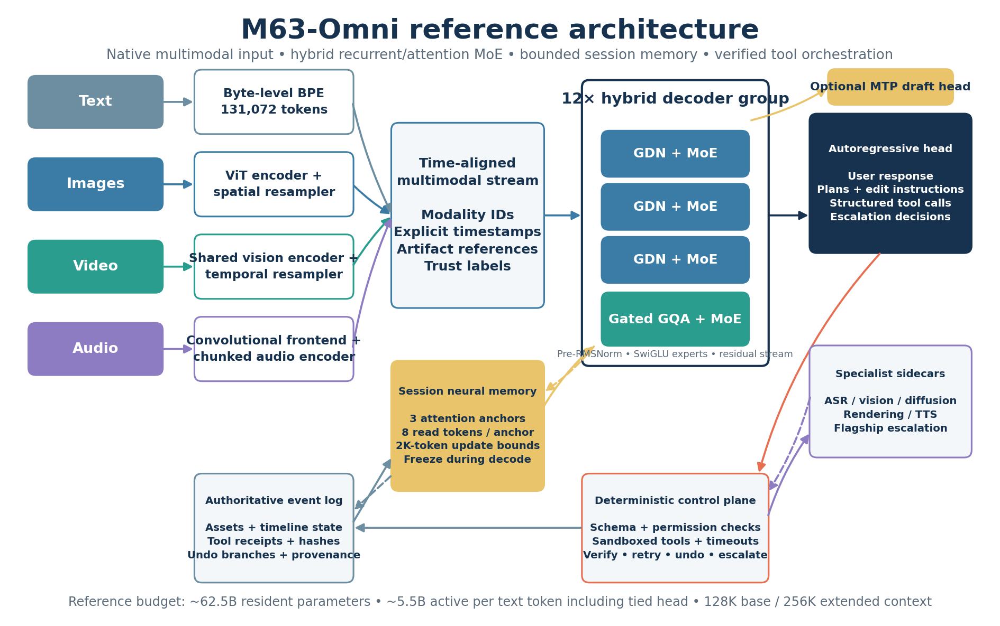

# M63-Omni — reference implementation

A from-scratch PyTorch reference implementation of the **M63-Omni mid-tier hybrid
multimodal orchestrator** blueprint ([`docs/blueprint.md`](docs/blueprint.md)): a
native-multimodal, autoregressive orchestrator with ~62.5B resident and ~5.0B active
parameters per text token, built from a 3:1 Gated DeltaNet / gated-GQA hybrid backbone,
a 64-expert sparse MoE, bounded session-scoped neural memory, and a deterministic
tool-orchestration control plane.



> **Status.** This is the blueprint's *numerical reference and engineering scaffold*
> (build-program steps 0–4): every component exists as a readable, tested reference
> implementation that optimised kernels and the distributed stack must match. There are
> **no trained weights** and **no capability or benchmark claims**. See
> [`docs/IMPLEMENTATION.md`](docs/IMPLEMENTATION.md) for the section-by-section map,
> documented design decisions, and what remains.

## What is here

| Package | Contents |
|---|---|
| `m63_omni/model` | GDN and gated-GQA mixers, dropless MoE with bias-balanced sigmoid router and node-limited routing, Titans-style memory anchors, MTP module, ViT/resampler/temporal/audio encoders, time-aligned AV interleaving, the full `M63Omni` model, code-generated parameter manifest and model card |
| `m63_omni/kernels` | Naive references + optimised forms: chunkwise-parallel GDN (exact segment-aware resets), attention, sort-based and padded-bmm grouped MoE, closed-form memory gradients |
| `m63_omni/data` | Byte-level BPE + 256 reserved special IDs, exact/near dedup, decontamination with source-event holdouts, PII/quality filters, provenance ledger and immutable manifests, the ten-stage §8 pipeline, token budgeting and AV chunk planning, Stage A–D mixtures, sequence packing |
| `m63_omni/train` | Combined objective, WSD schedule and batch ramp, reference trainer, exact checkpoint/resume with rolling + milestone tiers, router/numerics/spike monitors, distributed-layout validation |
| `m63_omni/runtime` | Authoritative hash-chained event log with branches and verified deletion, sessions (governed memory writes, media ingest via the artifact store, frozen-memory generation, CoW forks, branch adoption, replay, TTL reclaim), schema-guided decoding and the `ModelPlanner` that drives the orchestrator, paged KV with copy-on-write, safety-keyed prefix cache, MTP speculative decoding with full state rollback, capacity arithmetic |
| `m63_omni/agent` | `m63.actions/v1` envelopes, tool registry, deterministic control plane (static validation, permissions, idempotency, sandboxed execution, signed receipts), verifiers, calibrated escalation, orchestration loop |
| `m63_omni/eval` | Bootstrap CIs and per-cohort reports, scorer self-tests, release gates, long-context probes, efficiency and runtime-security suites |
| `configs/` | `full.yaml` (the blueprint §11 config), `long_context`, `serving`, `pilot` (10.6B/2.3B active), `proxy_1b3`, `proxy_300m`, and the proxy-tournament variants (1:1, 3:1, 7:1, full-attention control, memory-off, memory decay-to-M0, top-1/top-4, no-shared-expert) |

## Quick start

```bash
pip install -e ".[dev]"
```

```bash
python -m pytest
```

```bash
m63 manifest --config configs/full.yaml
```

```bash
m63 capacity
```

```bash
m63 train --steps 100
```

```bash
m63 release-check
```

```bash
m63 tournament --steps 20
```

`m63 manifest` instantiates the full model on PyTorch's `meta` device and counts every
parameter from code:

| Component | Resident | Active per text token |
|---|---:|---:|
| routed experts | 57.982B | 1.812B |
| shared experts | 0.906B | 0.906B |
| GDN mixers | 1.516B | 1.516B |
| gated GQA mixers | 0.705B | 0.705B |
| embedding (tied) | 0.537B | 0.537B as head |
| multimodal encoders | 0.637B | input-dependent |
| MTP | 0.177B | 0 in ordinary decoding |
| routers + memory | 0.026B | 0.026B |
| **total** | **62.486B** | **4.965B (5.501B incl. head)** |

Blueprint reference: 62.481B / 4.96B / 5.501B.

## Using the model

```python
import torch
from m63_omni import tiny
from m63_omni.model.m63 import M63Omni
from m63_omni.runtime.session import Session
from m63_omni.common import Trust

model = M63Omni(tiny(multimodal={"enabled": False})).eval()
session = Session(model, tenant_id="acme", session_id="edit-42")
first = session.ingest([11, 12, 13, 14], trust=Trust.USER)          # authoritative ingest event
session.ingest([99, 98, 97], trust=Trust.UNTRUSTED)                  # informs context, never writes memory
reply = session.generate(8)                                          # neural memory frozen while decoding
undo = session.fork(first.event_id, reason="undo")                   # copy-on-write branch at a committed event
session.delete()                                                     # removes KV/recurrent, memory, and log payloads
assert session.verify_deleted()
```

## Driving the control plane with the model

```python
from m63_omni.agent import ControlPlane, Orchestrator, Principal, ToolRegistry, apply_edit_tool
from m63_omni.runtime.planner import ModelPlanner, open_model_session

registry = ToolRegistry()
registry.register(apply_edit_tool())
cp = ControlPlane(registry, secret=b"replace-with-a-real-secret-0123456789")
editor = Principal("editor", "acme", frozenset({"timeline:write"}))
control_session, model_session = open_model_session(cp, editor, "edit-42", model)  # one shared event log
result = Orchestrator(cp, ModelPlanner(model_session, tokenizer)).run(control_session, "Trim c_17 and add a dissolve")
```

Every envelope the model produces parses as `m63.actions/v1` and every argument object
validates against its tool's schema by construction; the control plane still validates,
authorises, executes, signs, and verifies each call.

## Verified invariants (selected)

* Chunked GDN prefill equals the recurrent decode path (outputs, states, gradients) across
  chunk boundaries 1/63/64/65/127/129 and in-chunk document resets.
* Future-suffix replacement never moves earlier outputs, including through memory reads,
  segmented memory updates, and later AV windows.
* Packed documents are bit-for-bit isolated; MoE dispatch is dropless and all three kernels agree.
* Greedy MTP speculative decoding equals target-only decoding, and rejected drafts restore
  every recurrent, attention, and memory state.
* Checkpoint resume reproduces the uninterrupted run exactly on CPU.
* Untrusted content and generation never write persistent memory; cross-tenant reads fail;
  deletion is verifiable (including media blobs); memory snapshots are invalidated by
  model/tokenizer upgrades.
* Optional backends (FlexAttention block masks, `torch._grouped_mm` MoE, the
  flash-linear-attention GDN adapter, MTP drafting with an incremental cache) match the
  references; the MTP cache computes ~36x fewer drafter positions on a 300-token prompt.
* Every kernel and both mixer layers pass float64 finite-difference gradient checks; the
  Appendix B boundary lengths (through 32K at kernel level) and the maximum context are
  tested; sampled speculative decoding passes chi-square distribution tests.
* `m63 release-check` produces evidence for all six non-negotiable gates; injected tool
  output that a planner *obeys* still executes nothing unauthorised.
* CI (`.github/workflows/ci.yml`) runs lint, config validation, the test suite, the
  model-card freshness check, and the release check on Python 3.11–3.13; a nightly job runs
  the slow tests and a tournament smoke run.

## Repository layout

```
m63_omni/
  config.py   common.py   cli.py
  model/      kernels/    data/    train/    runtime/    agent/    eval/
configs/      # full, long_context, serving, pilot, proxies, tournament/
docs/         # blueprint.md (source design), IMPLEMENTATION.md (map + decisions), media/
tests/        # organised by Appendix B test family
```
