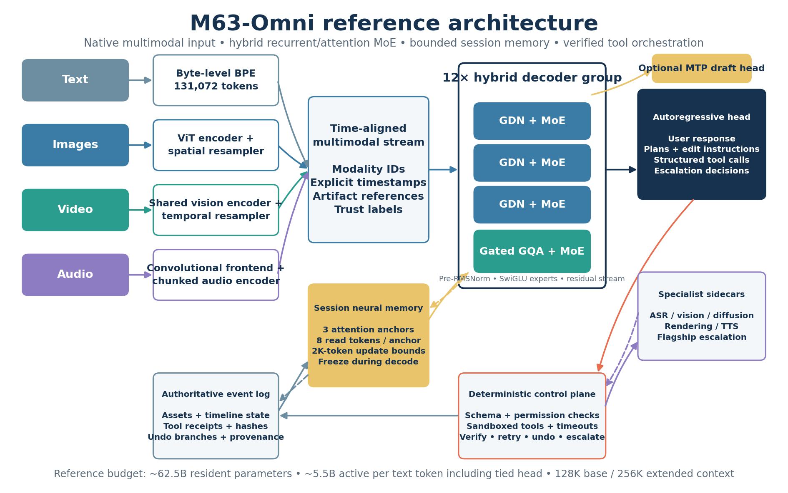

# M63-Omni: A Mid-Tier Hybrid Multimodal Orchestrator

> Source design document for this repository (converted from the original .docx). See `IMPLEMENTATION.md` for how each section maps to code.

**Corrected evidence base, reference architecture, and from-scratch
build plan**\
**Document date:** 2026-10-27\
**Status:** Engineering reference design, not a trained model or a claim
of measured performance

## Executive Summary

The recommended model is a **native-multimodal, autoregressive
orchestrator with approximately 62.5B resident parameters and 5.0B
active backbone parameters per text token**, or 5.5B when the tied
language-model head is included. Its 48-block backbone repeats three
Gated DeltaNet (GDN) blocks followed by one gated
grouped-query-attention (GQA) block. Every block contains a sparse
feed-forward layer with 64 routed experts, one shared expert, and top-2
routing. Text, image, audio, and video representations enter a common
time-aligned sequence; the model produces user responses, editing
instructions, structured tool calls, and escalation decisions.
Specialist systems remain responsible for rendering, diffusion
generation, speech synthesis, and flagship-level reasoning. This is
deliberately a middle tier: it has enough capacity for broad context and
tool use, but it does not attempt to reproduce the parameter count,
training budget, or expected capability of a frontier model.

Three changes substantially improve the original concept. Neural memory
is retained as a differentiating feature, but it is implemented as a
**bounded, session-scoped, checkpointable cache** rather than a
replacement for durable state; an authoritative event log remains
necessary for assets, tool receipts, undo branches, and deletion. Native
multimodality is included from the first full training run, while speech
generation and media generation stay outside the critical path. A
diffusion drafting head is deferred because it introduces a second
decoding objective and does not inherit Mercury's reported throughput by
association; one multi-token-prediction module provides a simpler
optional acceleration path. The proposed starting curriculum contains
4.75T text-equivalent token positions, but this is a scaling hypothesis
to be validated through proxy runs, not a promise that a particular
token count will produce a particular capability level.

  ------------------------------------------------------------------------
  **Decision**            **Reference choice**     **Reason and boundary**
  ----------------------- ------------------------ -----------------------
  Model tier              **62.48B resident /      Stays below flagship
                          4.96B active excluding   scale while retaining
                          tied head**              broad sparse capacity

  Backbone                48 blocks; **3:1         A strong starting
                          GDN-to-GQA**             prior, subject to 1:1,
                                                   3:1, and 7:1 proxy
                                                   ablations

  Sparse FFN              64 routed + 1 shared;    Capacity without
                          top-2; SwiGLU width      dense-FFN compute; all
                          1,536                    weights still must be
                                                   resident for serving

  Multimodality           Joint                    Native perception
                          text/image/audio/video   without turning v1 into
                          understanding; text/tool a speech- or
                          output                   video-generation
                                                   program

  Context                 128K base target; 256K   Long sessions remain
                          extended target          bounded by 12
                                                   attention-layer KV
                                                   caches

  Neural memory           Three attention anchors; Optional, gated session
                          eight read tokens per    cache with an event-log
                          anchor; 2K-token update  fallback
                          boundaries               

  Training                Proxy tournament →       Small runs retire
                          distributed pilot → full architecture risk; they
                          from-scratch run         are not substitutes for
                                                   the requested full
                                                   model

  Post-training           SFT → preference         Optimize final artifact
                          optimization →           correctness and
                          verifiable agentic RL    recovery, not merely
                                                   fluent plans

  Deferred features       Diffusion drafting,      Each requires separate
                          per-request TTT, native  evidence and must not
                          speech output,           endanger the core build
                          GDN-2/Mamba-3 promotion  
  ------------------------------------------------------------------------

## 1. Proofreading and Evidence Audit

The original draft has a clear and useful thesis: use a hybrid efficient
backbone, sparse activation, and adaptive memory to build a capable
middle model rather than another expensive attention-only flagship. Its
main weakness is rhetorical certainty. Phrases such as "the field
actually converged," "wrong pick," "near-perfect recall," and "the 2026
verdict" turn promising but context-dependent results into universal
conclusions. The technically stronger version distinguishes three
evidence levels: mechanisms demonstrated at relevant scale, mechanisms
demonstrated only in smaller or different settings, and design
hypotheses that still require matched experiments. It also avoids
treating a vendor's model name as evidence of its internal architecture.
The result remains ambitious, but every ambitious component now has a
fallback, an instrumentation plan, and a promotion gate.

Several corrections change engineering decisions rather than merely
improving wording. LFM2 supports hardware-aware architecture search, not
the claim that recurrent attention is universally inferior; its selected
backbone and block counts vary by model and deployment target
([LFM2](https://arxiv.org/html/2511.23404v1)). GDN, KDA, Mamba-3, and
GDN-2 should therefore be compared under the same data, state size, and
runtime budget. Titans supports a memory-as-context design and reports
BABILong results above GPT-4 baselines in its setup, but the draft's
"near-perfect recall at 2M+ tokens" is broader than the evidence
presented ([Titans](https://arxiv.org/html/2501.00663v1)). Most
importantly, a hybrid with 12 full-attention layers still has a growing
KV cache and quadratic work in those layers. It reduces attention costs;
it does not eliminate them.

  -------------------------------------------------------------------------------------------------------------------------------------------------------------------------
  **Draft statement**                 **Proofread and technically corrected version**
  ----------------------------------- -------------------------------------------------------------------------------------------------------------------------------------
  "Liquid AI themselves abandoned the "Liquid AI's LFM2 family uses deployment-specific hybrids selected through hardware-in-the-loop search. This does not prove that
  pure liquid architecture."          liquid time-constant networks are obsolete or that GDN is best for a GPU-served mid-tier model"
                                      ([LFM2](https://arxiv.org/html/2511.23404v1)).

  "LFM2 is 10 convolution blocks plus "That describes a specific released configuration, not every LFM2/LFM2.5 variant. Cite the exact checkpoint when giving block counts"
  6 attention blocks."                ([Liquid AI](https://www.liquid.ai/blog/liquid-foundation-models-v2-our-second-series-of-generative-ai-models)).

  "The field converged on roughly     "3:1 is a well-supported baseline used by Qwen3-Next and Kimi Linear
  3:1."                               ([Qwen3-Next](https://www.alibabacloud.com/blog/qwen3-next-a-new-generation-of-ultra-efficient-model-architecture-unveiled_602536),
                                      [Kimi Linear](https://arxiv.org/html/2510.26692v2)). OLMo Hybrid also uses this pattern ([OLMo
                                      Hybrid](https://arxiv.org/abs/2604.03444)). Other successful systems use different ratios, so treat 3:1 as a prior, not a consensus
                                      law" ([Granite](https://www.ibm.com/new/announcements/ibm-granite-4-0-hyper-efficient-high-performance-hybrid-models)).

  "OLMo Hybrid proves hybrids are     "OLMo Hybrid provides controlled 7B evidence and formal expressivity results for particular problem classes. It does not guarantee
  better."                            superiority for every dataset, scale, or modality" ([OLMo Hybrid](https://arxiv.org/abs/2604.03444)).

  "Mamba-3 beats Transformers by +2.2 "The reported +2.2-point result applies to Mamba-3 MIMO at 1.5B scale with 100B FineWeb-Edu tokens. It is not a mid-tier multimodal
  points."                            result" ([Mamba-3](https://arxiv.org/html/2603.15569v1)).

  "Titans hit near-perfect recall at  "Titans reports strong BABILong comparisons and effective scaling beyond 2M tokens in needle-style tasks. Remove 'near-perfect' and
  2M+ and beat GPT-4."                preserve the benchmark setting, model scale, and fine-tuning conditions" ([Titans](https://arxiv.org/html/2501.00663v1)).

  "TTT costs about 1.7× latency at    "Remove the fixed multiplier unless it is measured on the proposed module and serving stack. Inner-loop cost depends on memory width,
  four steps."                        chunking, kernel quality, batch shape, and whether state is reused."

  "A diffusion drafting head gives    "Mercury's figure belongs to complete diffusion coding models in a specific H100 serving evaluation. It does not transfer to an
  roughly 1,000+ tok/s."              attached head or to tool-heavy multimodal traffic" ([Mercury](https://arxiv.org/html/2506.17298v1)).

  "Pure linear models lose 5--10      "Pure recurrent models can lose precise retrieval capability because their state is finite, but there is no architecture-independent
  points on general tasks."           5--10-point penalty. Evaluate task- and scale-specific gaps" ([GDN](https://arxiv.org/abs/2412.06464)).

  "KAN fails at scale."               "Current evidence does not show a consistent advantage for KAN-family replacements in generalist language models. That is sufficient
                                      to exclude KAN from this critical path, not to declare the research direction a failure"
                                      ([KAN-SLM](https://arxiv.org/html/2607.15525v1), [KAT](https://arxiv.org/abs/2409.10594)).

  "No external vector DB is needed    "A vector database is optional for short-term working memory. A structured event store is still required for authoritative assets,
  for working memory."                provenance, recovery, permissions, and undo."

  "A two-hour session has fixed-size  "Recurrent layers have fixed-size state, but GQA KV grows with sequence length and multimodal inputs consume token positions. The
  state."                             design must budget both."

  "Reject full attention."            "Reject a second flagship-scale training program, not the attention mechanism. Retain a matched full-attention control at proxy and
                                      pilot scale."
  -------------------------------------------------------------------------------------------------------------------------------------------------------------------------

## 2. System Role, Requirements, and Boundaries

The middle model is the system's conversational and operational
controller. It receives a media brief, relevant multimodal context, the
current timeline, tool schemas, and verified tool results; it returns a
response and a bounded action proposal. It can describe an edit, choose
a sidecar, construct arguments, request a render probe, inspect the
result, and decide whether to repair the plan or escalate. It must not
directly execute code, mutate an asset store, authorize a purchase, or
bypass a policy check. A deterministic control plane owns those powers.
This separation makes model errors recoverable and allows tool
implementations, permissions, and verification rules to evolve without
retraining the backbone.

The first usable version is native in **multimodal understanding**, not
universal in generation. Text, images, audio, and video participate in
the initial model program and in the first full pretraining run; text
and structured actions are the only required outputs. This scope avoids
multiplying the project into a language model, speech synthesizer, image
generator, video generator, and editing engine simultaneously. It also
matches the model's role in the larger stack: sidecars already provide
specialist generation and rendering, while the flagship model handles
unusually difficult reasoning. The middle tier is successful when it
resolves routine work accurately and cheaply, preserves session state,
recognizes its limits, and makes clean handoffs.

  ------------------------------------------------------------------------
  **Requirement**         **v1 target**            **Explicit non-goal**
  ----------------------- ------------------------ -----------------------
  General conversation    Strong multilingual      Frontier-level
                          drafting, summarization, performance on every
                          explanation, and         reasoning task
                          instruction following    

  Media understanding     Joint                    Raw-frame generation or
                          text/image/audio/video   lossless perception of
                          encoding with timestamps every detail in a long
                          and artifact references  video

  Editing orchestration   Valid plans, tool calls, Unsandboxed execution
                          verification requests,   or direct asset
                          repair, and undo         mutation

  Long sessions           128K base context, 256K  Claimed infinite or
                          extension, bounded       lossless memory
                          session memory           

  Sparsity                Approximately 5B active  Assuming that sparse
                          backbone parameters per  activation reduces
                          text token               total checkpoint size
                                                   proportionally

  Escalation              Calibrated handoff based Escalating merely
                          on predicted failure and because the model
                          cost                     expresses uncertainty
                                                   in text

  Security                Tenant isolation,        Treating model output
                          trusted write paths,     or retrieved memory as
                          permission checks,       authorization
                          deletion, replayable     
                          receipts                 

  Operations              Checkpoint/resume, cache A research checkpoint
                          versioning, rollback,    without a supported
                          quality/latency          serving path
                          telemetry                
  ------------------------------------------------------------------------

## 3. Reference Architecture and Parameter Budget

The architecture is named **M63-Omni** only as a working label for this
document. Its text backbone has 48 residual decoder blocks arranged as
12 repetitions of `[GDN, GDN, GDN, Gated GQA]`. Each sequence-mixing
sublayer is followed by a sparse SwiGLU FFN. The hidden width is 4,096,
normalization is pre-RMSNorm, embeddings are tied, and the byte-level
BPE vocabulary has 131,072 entries. The GDN configuration uses 16 heads
with 128-dimensional keys and values, a 2,048-dimensional projected
inner width, short causal convolutions, and chunkwise training with
recurrent decoding. Each GQA layer has 32 query heads, eight key/value
heads, 128-dimensional heads, QK normalization, partial RoPE, and an
input-dependent output gate. The exact recurrent mixer remains swappable
because KDA, GDN-2, or Mamba-3 may win the proxy tournament.

The parameter count is derived from the proposed dimensions rather than
copied from another model. A SwiGLU expert has
`3 × 4,096 × 1,536 = 18,874,368` parameters. Across 48 layers, 64 routed
experts contribute 57.98B and one shared expert per layer contributes
0.906B. The recurrent and attention mixers contribute approximately
2.22B, the tied embedding contributes 0.537B, and the multimodal
encoders, memory projections, routers, and optional MTP module bring the
total to approximately 62.48B. Normal text decoding activates two routed
experts plus the shared expert in every block, producing 4.96B active
parameters before the tied output head and 5.50B including it.
Multimodal encoder compute is additional and depends on the input. These
figures must be regenerated from the implemented model's parameter
manifest before training starts.

  -------------------------------------------------------------------------
  **Component**       **Reference       **Resident        **Active per text
                      configuration**   parameters**      token**
  ------------------- ----------------- ----------------- -----------------
  Routed experts      64 per block;     57.982B           1.812B
                      top-2; width                        
                      1,536                               

  Shared experts      1 per block;      0.906B            0.906B
                      always active                       

  GDN mixers          36 blocks         1.516B            1.516B

  Gated GQA mixers    12 blocks         0.705B            0.705B

  Tied embedding / LM 131,072 × 4,096   0.537B            0.537B when
  head                                                    included

  Multimodal          Vision, temporal, 0.630B            Input-dependent
  encoders/adapters   audio, projection                   

  MTP module          One standard      0.180B            0 during ordinary
                      GQA + dense                         decoding
                      SwiGLU FFN, width                   
                      11,008                              

  Routers +           48 routers; 3     0.026B            0.026B
  neural-memory       memory anchors                      
  projections                                             

  **Total**           Reference         **62.481B**       **5.501B
                      estimate                            including tied
                                                          head**
  -------------------------------------------------------------------------

## 4. Block Mathematics and Memory Arithmetic

For block `l`, the residual computation is
`h_l = x_l + Mixer_l(RMSNorm(x_l))`, followed by
`x_{l+1} = h_l + MoE_l(RMSNorm(h_l))`. A conceptual GDN update can be
written as `S_t = α_t S_{t-1}(I − β_t k_t k_tᵀ) + β_t v_t k_tᵀ`, with
output `o_t = S_t q_t`; the decay and delta-style update provide global
forgetting and targeted association editing. The production
implementation must follow the exact tensor layout and numerical recipe
of the selected GDN kernel rather than reimplementing this abbreviated
equation blindly. GDN uses a chunkwise parallel form for
training/prefill and an equivalent recurrent form for decoding.
Cross-checking those paths is a correctness requirement, and cumulative
decay/gate calculations should use FP32 even when matrix multiplications
use BF16. GDN's parallel algorithm and retrieval motivation are
documented in the original paper
([GDN](https://arxiv.org/abs/2412.06464)).

For MoE block `l`, router affinity is `s_{i,t} = sigmoid(w_iᵀ h_t)`.
Selection uses the top two values of `s_{i,t} + b_i`, where `b_i` is a
load-balancing bias; output weights are computed from the original
affinities and normalized over the selected experts. The block output is
`Shared(h_t) + Σ_{i∈Top2} g_{i,t} Expert_i(h_t)`. This separation
prevents the balancing bias from directly changing expert output
magnitudes. Auxiliary-loss-free bias adjustment is one option supported
at large scale, but a small global-batch balancing loss is an acceptable
warm-up and fallback if the controller is unstable
([DeepSeek-V3](https://arxiv.org/html/2412.19437v2)). Token dropping is
forbidden in both training and inference; grouped or block-sparse expert
computation should handle variable loads instead
([MegaBlocks](https://arxiv.org/abs/2211.15841)).

The attention cache has an exact configuration-level lower bound. With
12 GQA layers, eight KV heads, 128 dimensions per head, separate keys
and values, and two-byte BF16 storage, each token requires
`12 × 2 × 8 × 128 × 2 = 49,152 bytes = 48 KiB`. This produces **1.5 GiB
at 32K, 6 GiB at 128K, and 12 GiB at 256K per session**, before paging
and allocator overhead. A 48-layer control with the same GQA shape needs
four times as much. The 36 GDN states use approximately
`36 × 16 × 128 × 128 × 2 bytes = 18 MiB` per session, and the proposed
neural-memory weights plus momentum use about 3 MiB. These are derived
values, not benchmarks; production capacity planning must add multimodal
caches, memory pages, fragmentation, activations, and
speculative-decoding state.

## 5. Native Multimodal Architecture and Token Economics

The multimodal front end uses separately trainable encoders but a shared
causal reasoning backbone. "Native" here means that the encoders,
adapters, and backbone are part of one training program and are
optimized jointly from the early full-model run; it does not require an
encoder-free design. The vision encoder is a 24-layer, width-1,024 ViT
with 16 heads and patch size 14, followed by a spatial resampler. Video
shares that encoder and adds a four-layer temporal aggregator. The audio
front end resamples input to 16 kHz, computes 128-channel mel features
with a 25 ms window and 10 ms hop, downsamples by 16, and feeds a
20-layer, width-1,024 chunk-aware transformer. This produces
approximately 6.25 audio representations per second. Qwen3-Omni supports
the value of mixing unimodal and cross-modal data early, while
Qwen3.5-Omni provides a relevant precedent for chunked encoders,
explicit timestamps, and hybrid MoE perception
([Qwen3-Omni](https://arxiv.org/html/2509.17765v1),
[Qwen3.5-Omni](https://arxiv.org/html/2604.15804v1)).

All modalities are mapped into the 4,096-dimensional residual stream and
annotated with modality IDs, asset IDs, trust labels, and explicit text
timestamps. Audio and video chunks are interleaved in timestamp order
rather than concatenating an entire video followed by its soundtrack.
This makes temporal alignment learnable and gives the orchestrator a
natural way to request a precise interval. A long proxy uses adaptive
visual sampling: 0.5 frames per second and 16 visual tokens per frame by
default, with short high-detail intervals encoded at 1 frame per second
and up to 64 tokens per frame. Frame-accurate inspection, OCR, object
tracking, and render validation remain sidecar tasks. Adaptive sampling
is a budget policy, not a guarantee that half-rate video contains every
action or edit-relevant detail.

  ------------------------------------------------------------------------
  **Input**         **Encoder and     **Default         **Auxiliary
                    alignment**       representation    training signals**
                                      policy**          
  ----------------- ----------------- ----------------- ------------------
  Text / code       Byte-level BPE;   131,072-token     Next-token loss,
                    tied embeddings;  vocabulary;       structured-text
                    special tool and  reserve 256       parsing,
                    timestamp tokens  special IDs       multilingual
                                      initially         fertility checks

  Image             24-layer ViT;     16--256 tokens    Contrastive
                    spatial           depending on      alignment,
                    resampler;        resolution and    captioning, OCR,
                    modality and      task              spatial and
                    spatial IDs                         document QA

  Video             Shared ViT +      0.5 fps × 16      Temporal ordering,
                    four-layer        tokens for        timestamp QA, shot
                    temporal          proxies;          boundaries, action
                    aggregator        high-detail short and edit
                                      intervals on      descriptions
                                      demand            

  Audio             Mel frontend +    Approximately     CTC/ASR, audio
                    20-layer chunked  6.25 tokens/s;    captioning, event
                    encoder           12.5 tokens/s for detection,
                                      short             cross-modal
                                      high-fidelity     alignment
                                      intervals         

  Audio-video       Shared timestamps Interleaved       Synchronization,
                    and contiguous    chunks, normally  temporal
                    modality position every 2--4        grounding,
                    IDs               seconds           speaker/event
                                                        correspondence

  Tool / artifact   JSON schemas,     Never paste raw   Schema prediction,
                    artifact hashes,  binary assets     result
                    typed references  into the residual interpretation,
                                      stream            verification and
                                                        recovery
  ------------------------------------------------------------------------

At the default long-proxy rate, a two-hour session uses
`7,200 × 0.5 × 16 = 57,600` video tokens and `7,200 × 6.25 = 45,000`
audio tokens. Two marker tokens every four seconds add 3,600 positions,
and an 8,000-position allowance covers the brief, tool receipts, and
working text. The resulting **114,200-position estimate fits a 128K
window with 16,872 positions remaining**. This is an engineering budget
illustration rather than an accuracy claim. A session with 12.5 audio
tokens/s, denser frames, multiple assets, or large tool outputs must use
the 256K configuration, a shorter working interval, or memory-backed
chunked ingestion. The loader must estimate token cost before encoding
and select a sampling policy explicitly rather than truncating silently.

## 6. Titans-Style Memory and Session-State Governance

The model includes three neural-memory anchors at GQA layers 16, 32, and
48. Each anchor retrieves eight memory tokens and appends their keys and
values to that layer's attention context, following the
memory-as-context intuition rather than inserting another full recurrent
stack. Each memory is a two-layer MLP with dimensions `256 → 512 → 256`;
projections to and from the 4,096-dimensional backbone are shared across
sessions and learned during training. A learned initialization `M₀` is
stored in the checkpoint and copied when a session starts. The session
owns only the small memory weights and momentum state; backbone weights
never update at inference. At every 2,048-token boundary, the model may
update each anchor from that anchor's own detached hidden-state segment,
preserving depth-specific representations. During ordinary
token-by-token response generation, memory is read-only, preventing
unverified prose from immediately becoming authoritative session
knowledge.

For each segment, an associative loss compares `M(k_t)` with a target
value `v_t`, and its inner gradient measures surprise under that
objective. A bounded update is `g_t = clip(∇_M ℓ(M;k_t,v_t))`,
`s_t = η_t s_{t-1} − θ_t g_t`, and `M_t = (1 − α_t) M_{t-1} + s_t`. The
gates `η_t`, `θ_t`, and `α_t` are learned and bounded; inner gradients
and momentum are normalized and clipped. Training unrolls only a small
number of segments, using truncated backpropagation and random reset
points to teach both retention and forgetting. Titans motivates the
momentum-and-decay mechanism and memory-as-context integration, but its
reported experiments are much smaller than this model and do not
validate this serving design
([Titans](https://arxiv.org/html/2501.00663v1)). The memory module
therefore ships behind an ablation gate and can be disabled without
changing the rest of the checkpoint.

The state model deliberately distinguishes exact working context,
compressive neural memory, and durable event history. Recurrent states
and attention KV represent the current prefix; neural memory offers
approximate session-level retrieval; the event log records authoritative
artifacts and actions. A branch in an editing session receives
copy-on-write recurrent and neural-memory snapshots plus a new event-log
branch identifier. A delete operation removes all three forms according
to policy. A model or tokenizer upgrade invalidates old neural-memory
snapshots unless a compatibility test passes, while event-log artifacts
remain independently readable. This approach preserves the original
idea's efficiency without making an opaque tensor the only record of
what the system did.

  -------------------------------------------------------------------------
  **State layer**     **Contents**      **Lifetime and    **Trust and
                                        branching**       recovery rule**
  ------------------- ----------------- ----------------- -----------------
  Working context     Current token     Request/session   Exact within the
                      embeddings, GDN   prefix;           active model
                      state, GQA KV,    recomputable from version; never
                      active tool       event history     shared across
                      result                              tenants

  Session neural      Three MLP states  Session-scoped;   Disposable
  memory              and momentum,     copy-on-write     accelerator;
                      approximately 3   branches; TTL and snapshot with
                      MiB               reset supported   model, tokenizer,
                                                          and event IDs

  Authoritative event Assets, timeline  Durable by        Source of truth
  log                 versions, plans,  policy;           for replay,
                      receipts, hashes, append-only       audit, undo, and
                      permissions,      history with      recovery
                      provenance        branch and delete 
                                        semantics         

  Request-scoped      Untrusted         Discarded at task May inform the
  quarantine          documents, web    end unless        current task;
                      results, and      explicitly        cannot silently
                      unverified tool   promoted          become persistent
                      content                             instruction
                                                          memory

  User/organization   Explicitly        Separate opt-in   Never inferred
  memory              approved          store with        solely from
                      preferences and   provenance        surprising or
                      facts                               frequent input
  -------------------------------------------------------------------------

Memory writes are privileged operations. Untrusted tool output is
quarantined by default, user-approved facts carry provenance, and
instruction-like content is never promoted into a higher-trust system or
developer role. These controls address a real failure mode: current
OWASP guidance calls out persistent compromise through memory poisoning
and recommends privileged treatment for memory writes, while recent
multi-session research shows that planted payloads can affect later
behavior
([OWASP](https://github.com/GenAI-Security-Project/GenAI-LLM-Top10/blob/main/2026/final/LLM01_PromptInjection.md),
[Bad Memory](https://arxiv.org/html/2607.14611v1)). Release testing must
include cross-tenant isolation, delayed payloads, malicious audio, undo
after poisoning, snapshot deletion, and a memory-off fallback. Promotion
requires a measurable long-session gain, no meaningful short-context
regression, acceptable latency, and zero unauthorized actions in the
security suite.

## 7. MoE Routing, Stability, and Capacity Controls

Fine-grained experts and a shared expert are appropriate for this tier
because they separate common transformations from specialized capacity.
DeepSeekMoE provides the architectural precedent for shared-expert
isolation and fine-grained segmentation, but it does not dictate this
exact expert count or top-k
([DeepSeekMoE](https://arxiv.org/abs/2401.06066)). The proposed router
uses normalized sigmoid affinities, top-2 selection, and a balancing
bias updated from measured global-batch load. Node-limited routing
restricts each token to experts on at most two nodes to bound all-to-all
traffic. The shared expert can overlap with dispatch and routed
computation where the framework supports it. Expert load, entropy, token
modality, and communication time are logged per layer, making it
possible to detect a router that appears balanced in aggregate but
collapses for audio, video, code, or a particular language.

The implementation is dropless and uses dynamic grouped-GEMM or
block-sparse expert batches. Capacity estimates are used for memory
planning and alerts, not for silently discarding overflow tokens. During
training, an initial small balancing loss may stabilize routing while
the bias controller is validated; it can be annealed when batch-level
balance is consistently achieved. Router statistics are computed in
FP32, and a small z-loss is available if logits drift. A dead-expert
alarm fires when an expert receives no tokens over a configurable large
token window; an overload alarm fires when the busiest expert repeatedly
exceeds a measured multiple of the mean. These alarms must be segmented
by modality and batch composition, since video-heavy microbatches can
otherwise hide severe imbalance.

Stability features are selected to be useful rather than novel. QK
normalization constrains attention logits, the gated attention output
provides a learned path for suppressing unstable activations, recurrent
decay/gate arithmetic uses FP32, and gradient clipping is enabled
globally. The first production training recipe is BF16 with FP32 master
weights and optimizer accumulations; FP8 is introduced only after a
matched run demonstrates acceptable loss and downstream parity.
Megatron-Core supplies the required expert, tensor, pipeline, context,
and data-parallel mechanisms, but the custom GDN and memory modules
still need implementation and validation
([Megatron-Core](https://arxiv.org/html/2603.07685v2)). Sparse
activation reduces per-token expert compute, not the resident checkpoint
size, serving weight traffic, or the need for robust expert-parallel
communication.

  -----------------------------------------------------------------------
  **Control**             **Initial setting**     **Metric and failure
                                                  response**
  ----------------------- ----------------------- -----------------------
  Routed experts          64 per block; top-2     Track selected experts,
                                                  load, entropy, and
                                                  modality; ablate
                                                  top-1/top-4 at proxy
                                                  scale

  Shared expert           One SwiGLU expert per   Compare against
                          block                   no-shared-expert
                                                  control under matched
                                                  active compute

  Balancing               Bias controller;        Roll back to
                          optional small warm-up  global-batch auxiliary
                          auxiliary loss          loss if load or quality
                                                  becomes unstable

  Routing locality        At most two nodes per   Measure all-to-all time
                          token                   and rerouting failures;
                                                  relax only after
                                                  profiling

  Token handling          Dropless training and   Any token drop is a
                          inference               correctness bug and
                                                  blocks the run

  Numerics                FP32 router,            NaN/Inf guards,
                          normalization,          activation percentiles,
                          decay/gates; BF16 GEMMs gradient norms,
                          initially               loss-spike replay

  Checkpoint contents     Weights, optimizer,     Resume must reproduce
                          router biases, RNG,     the uninterrupted run
                          data order, memory      within the defined
                          initialization          numerical tolerance
  -----------------------------------------------------------------------

## 8. Data Engine and Training Curriculum

The starting full-run budget is **4.75T text-equivalent token
positions**, where a position is counted after text tokenization or
modality projection. This unit is useful for sequence planning but not
for claiming equal compute: a video position incurs encoder cost that a
text position does not. The sampler therefore starts from the sampling
percentages below and converts them into measured compute-normalized
weights after the pilot. The mixture keeps substantial text-only data to
reduce modality-induced forgetting and includes synchronized audio-video
data throughout, not as a late adapter stage. Public recipes support
staged general, capability-focused, and long-context curricula, but
their token counts are examples rather than requirements for this model
([Qwen3](https://arxiv.org/html/2505.09388v1), [OLMo
3](https://arxiv.org/html/2512.13961)). Chinchilla's dense-model scaling
relationship is likewise a reference point, not a valid "20 tokens per
total MoE parameter" rule for this architecture
([Chinchilla](https://proceedings.neurips.cc/paper/2022/file/c1e2faff6f588870935f114ebe04a3e5-Paper-Conference.pdf)).

Data quality is the largest program risk because the architecture cannot
compensate for poor alignment, contaminated evaluations, or unusable
rights. Candidate pools can include Dolma-style web/science/code mixes
and DataComp-style image-text pools ([OLMo
3](https://arxiv.org/html/2512.13961),
[DataComp](https://arxiv.org/abs/2304.14108)). Panda-style video-caption
collections are another candidate family, but every source requires an
independent license, consent, privacy, and takedown review
([Panda-70M](https://arxiv.org/html/2402.19479v1)). "Open" describes
access, not necessarily permission for every downstream use.
High-quality audio-video data will likely require a combination of
licensed media, commissioned annotations, public domain material,
consented user data, and carefully verified synthetic captions.
Synthetic captions are labeled as such and evaluated for temporal and
visual grounding; fluent but unsupported descriptions are rejected.

  ---------------------------------------------------------------------------------------
  **Stage**      **Positions**   **Sequence       **Compute-normalized   **Main purpose**
                                 curriculum**     sampling starting      
                                                  point**                
  -------------- --------------- ---------------- ---------------------- ----------------
  A --- joint    3.50T           Predominantly    60% text/code; 10%     Language, world
  foundation                     4K; native       image; 10% video; 10%  knowledge,
                                 multimodal       audio; 10%             perception,
                                 batches from the synchronized AV        basic
                                 start                                   cross-modal
                                                                         alignment

  B ---          0.75T           8K--32K          50% text/code; 12%     STEM/code,
  capability                                      image; 14% video; 12%  document
  mid-training                                    audio; 12%             understanding,
                                                  synchronized AV        richer temporal
                                                                         and
                                                                         tool-adjacent
                                                                         data

  C ---          0.35T           32K→128K         55% text/code; 10%     Long documents,
  long-context                                    image; 15% video; 10%  long videos,
  training                                        audio; 10%             retrieval,
                                                  synchronized AV        aggregation,
                                                                         session tracking

  D --- memory   0.15T           128K→256K        45% text/code; 5%      Multi-segment
  and ultra-long                                  image; 20% video; 10%  memory,
  adaptation                                      audio; 20%             branching
                                                  synchronized AV        sessions,
                                                                         long-horizon
                                                                         tool traces

  **Total**      **4.75T**       Stage-specific   Rebalance from         Starting budget;
                                 packing and      measured pilot cost    continue only
                                 context          and quality            while scaling
                                 parallelism                             curves justify
                                                                         it
  ---------------------------------------------------------------------------------------

The data pipeline has ten mandatory transformations: inventory and
provenance; language/modality identification; exact and near
deduplication; quality filtering; safety and privacy filtering;
benchmark decontamination; media decoding and integrity checks;
timestamp/alignment construction; tokenization and packing; and
immutable manifest generation. Text uses document-level deduplication
plus approximate matching, while media uses hashes and embedding-based
near-duplicate detection across frames, clips, and audio. Evaluation
decontamination covers captions, transcripts, frames, and
near-duplicates, with holdouts split by source event rather than random
clip so that adjacent segments cannot leak across train and test. Packed
sequences carry document-boundary masks and recurrent-state reset flags.
Every batch can be reproduced from a manifest containing source
versions, transformations, seeds, and ordering.

## 9. Training Objectives, Hyperparameters, and Post-Training

The main objective is causal next-token prediction over text and
structured action tokens. Encoder-specific objectives are added where
they provide information that captions alone cannot supply: CTC/ASR for
speech, contrastive alignment for cross-modal retrieval, temporal
ordering and timestamp prediction for video, and document/OCR objectives
for images. The combined loss is
`L = L_AR + λ_ctc L_CTC + λ_align L_align + λ_time L_time + λ_bal L_balance + λ_MTP L_MTP + λ_mem L_memory`.
Loss weights are normalized by valid target count and measured gradient
magnitude, not by raw batch item count. Text-only, unimodal,
cross-modal, and missing-modality batches are all required. Modality
dropout teaches graceful degradation, while a text-only control run
measures whether joint training damages general language quality.

The following hyperparameters are initialization points for proxy
tuning, not universal optima. The full model uses AdamW with a peak
learning rate near `2×10⁻⁴`, betas `(0.9, 0.95)`, weight decay 0.1,
gradient clipping 1.0, and a warmup of roughly 1B positions. Global
batch size ramps from 2M to 8M positions during early training. A
warmup--stable--decay schedule allows intermediate evaluation and
continuation; long-context stages use a lower peak, initially in the
`2×10⁻⁵` to `5×10⁻⁵` range. BF16 is the numerical baseline, with FP32
master weights, optimizer states, routers, normalization, and sensitive
recurrent gates. FP8 is considered only after kernel-level parity and a
multi-billion-token matched training test, informed by recipes that
leave sensitive operations in higher precision ([Transformer
Engine](https://docs.nvidia.com/deeplearning/transformer-engine/),
[MXFP8](https://arxiv.org/html/2506.08027v2)).

Post-training begins with supervised instruction tuning over general
conversation, multilingual tasks, multimodal understanding, tool
schemas, long sessions, and failure recovery. A second stage uses
rejection sampling and preference optimization to improve helpfulness,
concision, instruction following, and repair quality. The final
capability stage uses multi-turn RL with verifiable outcomes:
JSON-schema validity, final timeline state, successful render probes,
unit-tested tool arguments, and task completion. A small cost penalty
discourages pointless loops and unnecessary flagship calls, but positive
reward is tied primarily to the verified terminal result rather than the
number of successful tool invocations. Agentic RL research supports
final-state verification and highlights the importance of stable user
simulation and meaningful reward variation
([AReaL-SEA](https://arxiv.org/html/2601.22607v3)).

  -----------------------------------------------------------------------
  **Phase**               **Initial planning      **Content and
                          range**                 acceptance condition**
  ----------------------- ----------------------- -----------------------
  General + multimodal    1--5B supervised        Instructions, grounded
  SFT                     positions               captions, QA,
                                                  documents, code,
                                                  missing-modality cases;
                                                  improve without
                                                  text-only regression

  Orchestrator SFT        Included above, with a  Real tool schemas,
                          dedicated tracked slice successful and failed
                                                  calls, undo, retries,
                                                  branch handling,
                                                  escalation labels

  Long-session SFT        Included above, with    Multi-asset timelines,
                          long-context weighting  distributed facts,
                                                  memory resets,
                                                  quarantined content,
                                                  checkpoint recovery

  Preference optimization 50--200M positions as a Length-normalized
                          starting range          comparisons; preserve
                                                  tool validity and
                                                  groundedness

  Verifiable agentic RL   100K--1M trajectories   Terminal-state reward,
                          as an initial program   deterministic
                          range                   verifiers, dynamic task
                                                  filtering, holdout by
                                                  workflow family

  Safety and release      Determined by uncovered Prompt injection,
  tuning                  failure modes           privacy, deletion,
                                                  over-authorization,
                                                  unsafe media,
                                                  escalation calibration
  -----------------------------------------------------------------------

## 10. Orchestrator Contracts, Verification, and Escalation

The model communicates with the control plane through a versioned
envelope rather than free-form tool syntax embedded in prose. A response
contains an optional user-facing message, a plan identifier, zero or
more action calls, verification requirements, and an escalation
decision. Every call includes a tool name and version, JSON-schema-valid
arguments, an idempotency key, expected input and output artifact hashes
where available, a timeout class, and a verification policy. The runtime
rejects unknown fields, checks permissions, executes in a sandbox, and
returns a signed or hashed receipt. Raw media stays in artifact storage;
the model receives typed references and compact representations. This
makes retries safe, supports undo, and prevents a plausible-looking plan
from becoming an unauthorized state change.

The orchestration loop is
`intake → context bundle → plan → static validation → execute → verify → repair/branch → finalize`.
Static validation checks schemas, permissions, resource limits, media
constraints, and contradictory edits before execution. Verification is
task-specific: a timeline edit may require schema comparison plus a
short render probe; a caption may require timestamp and evidence checks;
code may require unit tests. The model can propose repairs only within a
bounded number of attempts and a fixed cost budget. An undo operation
creates or restores a named branch rather than destructively reversing
an unverified sequence. Successful paths, failed paths, and recovered
paths all become training examples after decontamination and quality
review.

    {
      "schema_version": "m63.actions/v1",
      "plan_id": "session_42/branch_7/plan_19",
      "assistant_message": "I’ll create a draft cut and verify the transition before rendering.",
      "calls": [
        {
          "tool": "timeline.apply_edit@2",
          "arguments": {
            "timeline_id": "asset_91",
            "operations": [
              {"op": "trim", "clip_id": "c_17", "start_ms": 12400, "end_ms": 26800},
              {"op": "transition", "after_clip_id": "c_17", "kind": "dissolve", "duration_ms": 400}
            ]
          },
          "idempotency_key": "session_42/branch_7/plan_19/call_1",
          "timeout_class": "standard_media_edit",
          "verify": ["timeline_schema", "render_probe", "transition_probe"]
        }
      ],
      "budget": {"max_calls": 4, "max_repair_attempts": 1},
      "escalation": {"required": false, "reason": null}
    }

Escalation is an economic and reliability decision, not a personality
trait. A small calibrated router estimates `p_fail` from verifier
outcomes, constraint complexity, domain shift, previous repair failures,
and model disagreement. It escalates when
`p_fail × Cost_failure + Expected_quality_gain > Cost_escalation`,
subject to hard rules for unsupported tools, unsafe actions, or
user-requested flagship review. The language model supplies features but
does not get an unreviewed veto over the policy. Training labels come
from pilot tasks scored by stronger models and deterministic verifiers.
Evaluation reports both hard-task recall and unnecessary escalation
rate, because optimizing only one produces either excessive failures or
excessive cost. The threshold and feature definitions are versioned with
the serving policy so that behavior can be reproduced and rolled back
independently of the checkpoint.

  -----------------------------------------------------------------------
  **Interface**           **Required fields**     **Runtime behavior**
  ----------------------- ----------------------- -----------------------
  Action request          Schema version,         Reject invalid or
                          plan/branch IDs, tool   unauthorized requests
                          version, arguments,     before execution
                          idempotency key, budget 

  Tool receipt            Status, artifact        Append to event log;
                          references, hashes,     redact secrets; return
                          metrics, error class,   compact structured
                          trust label             summary

  Verification request    Probe type, target      Run deterministic
                          artifact, acceptance    checks first; use model
                          predicate, evidence     review only where
                          location                necessary

  Branch request          Parent event, reason,   Copy-on-write
                          expected state, memory  recurrent/neural state;
                          snapshot ID             create independent
                                                  event branch

  Escalation request      Failed capability,      Route to flagship with
                          evidence, attempted     minimal sufficient
                          repairs, remaining      context and explicit
                          budget                  constraints

  Final response          User message, completed Never claim successful
                          artifacts, verification execution without a
                          summary, unresolved     matching receipt
                          issues                  
  -----------------------------------------------------------------------

## 11. Distributed Implementation and Reference Configuration

The recommended implementation stack combines PyTorch, Megatron-Core for
distributed training, optimized GDN/KDA-family kernels,
FlashAttention-class GQA kernels, grouped-GEMM MoE dispatch, and a
custom serving integration. Transformer Engine can supply
mixed-precision building blocks after compatibility testing, while vLLM
or a comparable runtime supplies continuous batching and paged
attention. Hybrid state is more complicated than an ordinary transformer
cache: the serving manager must coordinate paged GQA KV, fixed-size
recurrent states, multimodal content hashes, memory snapshots, and
copy-on-write branches. Current vLLM hybrid-cache work illustrates the
need to manage these state types together and to handle recurrent-prefix
reuse carefully
([vLLM](https://docs.vllm.ai/en/latest/design/hybrid_kv_cache_manager/),
[Hybrid
Models](https://pytorch.org/blog/hybrid-models-as-first-class-citizens-in-vllm/)).
These components are integration references, not claims that the
proposed model works out of the box.

The full model begins with BF16 and a conservative parallel layout. On a
256-GPU illustrative cluster, short-context training can start with
tensor parallelism 4, pipeline parallelism 4, context parallelism 1,
data parallelism 16, and expert parallelism 8 with two expert-data
replicas. Long-context training can evaluate tensor parallelism 4,
pipeline parallelism 4, context parallelism 4, data parallelism 4, and
expert parallelism 4. These are starting topologies, not universal
settings: the exact folding of expert and data parallel groups must be
checked in the pinned Megatron version, and memory must be measured from
the real model. Pipeline stages should respect the four-block hybrid
groups so that attention and recurrent states have predictable
placement. The distributed optimizer shards optimizer state, and
checkpoints include every router bias and data-loader cursor.

    model:
      name: m63_omni
      hidden_size: 4096
      layers: 48
      hybrid_pattern: [gdn, gdn, gdn, gated_gqa]  # repeat 12 times
      vocab_size: 131072
      tie_embeddings: true
      norm: rmsnorm_pre
      context_targets: [131072, 262144]
    gdn:
      heads: 16
      key_dim: 128
      value_dim: 128
      inner_width: 2048
      conv_kernel: 4
      train_chunk: 64
      decode_mode: recurrent
      decay_gate_dtype: float32
    attention:
      query_heads: 32
      kv_heads: 8
      head_dim: 128
      rotary_dims: 32
      qk_norm: true
      output_gate: true
    moe:
      routed_experts: 64
      shared_experts: 1
      top_k: 2
      expert_hidden: 1536
      activation: swiglu
      router: normalized_sigmoid_with_load_bias
      max_nodes_per_token: 2
      token_dropping: false
    memory:
      enabled: true
      anchors: [16, 32, 48]
      read_tokens_per_anchor: 8
      update_segment_tokens: 2048
      mlp_shape: [256, 512, 256]
      freeze_during_decode: true
      untrusted_persistent_writes: false
    mtp:
      layers: 1
      mixer: standard_gqa
      dense_ffn_hidden: 11008
      draft_tokens: 2
    multimodal:
      vision_layers: 24
      vision_width: 1024
      temporal_layers: 4
      audio_layers: 20
      audio_width: 1024
      audio_sample_rate: 16000
      audio_tokens_per_second: 6.25
      explicit_timestamps: true
    training:
      precision: bf16
      optimizer: adamw
      peak_lr: 0.0002
      betas: [0.9, 0.95]
      weight_decay: 0.1
      clip_grad_norm: 1.0
      global_batch_tokens: 8388608
      schedule: warmup_stable_decay
      token_dropping: false
    runtime:
      paged_kv: true
      recurrent_state_manager: true
      multimodal_prefix_hash: true
      copy_on_write_branches: true
      memory_off_fallback: true

A practical repository separates model mathematics, optimized kernels,
data, training, runtime, agent contracts, and evaluation. The naive
implementation is the numerical reference; optimized code cannot become
authoritative until it matches that reference. Data and runtime code
share the same modality and trust schemas, preventing training/serving
skew. Configuration files are immutable for each run and include a
generated parameter manifest. The project also contains a small "model
card config" generated from the same source of truth, eliminating the
common failure where documentation and the actual checkpoint disagree.
Continuous integration executes the reference tests on every change,
while nightly jobs exercise distributed and long-context paths.
Performance optimizations are merged only with before/after traces and a
reproducible correctness report, so speed cannot quietly become more
important than state fidelity.

    m63_omni/
      configs/            # proxy, pilot, full, long-context, serving
      model/              # blocks, encoders, memory, MTP, parameter manifest
      kernels/            # GDN, GQA, grouped MoE, memory updates
      data/               # manifests, filters, alignment, packing, tokenizer
      train/              # objectives, schedules, distributed loop, checkpoints
      runtime/            # hybrid cache, sessions, branches, serving adapter
      agent/              # schemas, control-plane API, verifiers, escalation
      eval/               # public suites, session tasks, security, efficiency
      tests/              # unit, numerical, distributed, resume, security tests

## 12. Step-by-Step Build Program

The program below preserves the requested full mid-tier training run
while forcing irreversible decisions to occur after evidence exists.
Proxy models are not the product; they are controlled experiments for
selecting the recurrent block, attention ratio, router, memory
mechanism, and data mixture. The full architecture is frozen only after
a native-multimodal distributed pilot demonstrates numerical
correctness, useful quality, stable routing, acceptable throughput, and
a working serving path. Data acquisition, annotation, and governance
begin at step zero because they are likely to dominate the calendar.
Each gate has an explicit artifact and a failure action, preventing a
large run from continuing merely because compute has already been spent.

The full run uses checkpoint tiers with different retention policies.
Rolling checkpoints contain weights, optimizer state, router biases,
scaler state, RNG, data order, and configuration and are retained for
immediate recovery. Milestone checkpoints are frozen every 25--50B
positions or at a measured validation interval and retained for
architecture comparisons. Every milestone runs a small deterministic
evaluation pack before the next stage begins. If a loss spike occurs,
the replay starts from the last clean checkpoint with the exact batch
manifest, making it possible to distinguish a data event from a
numerical or hardware event. No full-stage transition is based only on
training loss.

  -------------------------------------------------------------------------
  **Step**                **Work package**        **Required artifact and
                                                  go/no-go gate**
  ----------------------- ----------------------- -------------------------
  0                       Freeze role,            Signed requirement sheet;
                          modalities, SLOs, risk  benchmark and media
                          policy, eval holdouts,  holdouts are isolated
                          and rights policy       before data processing

  1                       Implement naive text    Single-GPU
                          backbone, modality      forward/backward works;
                          interfaces, and         manifest reproduces the
                          parameter counter       62.48B reference when
                                                  instantiated at full
                                                  shape

  2                       Implement GDN, GQA,     Shapes, masks, resets,
                          MoE, and memory         causality, and state
                          reference modules       transitions pass unit
                                                  tests

  3                       Add optimized kernels   FP32/FP16/BF16 tolerances
                          and compare with        documented; chunk prefill
                          reference               and recurrent decode
                                                  agree; gradients are
                                                  finite

  4                       Build tokenizer,        Fertility, timestamp,
                          provenance ledger,      sync, corruption, dedup,
                          media pipeline, and     decontamination, and
                          packing                 reset tests pass

  5                       Pretrain vision/audio   Encoder-only retrieval,
                          encoders from random    ASR, OCR, and temporal
                          initialization          tasks beat frozen/random
                                                  controls

  6                       Run 300M--1.3B          Compare 1:1/3:1/7:1,
                          native-multimodal proxy GDN/KDA/GDN-2/Mamba-3,
                          tournament for roughly  MoE choices, and memory
                          50--100B positions per  on/off under matched
                          finalist                budgets

  7                       Select finalists and    Stable loss/routing;
                          run an 8--12B-total,    useful multimodal
                          approximately 2B-active quality; measured MFU and
                          distributed pilot for   memory; serving prototype
                          200--300B positions     works

  8                       Freeze full             Chosen candidate wins on
                          configuration and fit   Pareto
                          continuation/scaling    quality/latency/memory;
                          curves                  full token budget and
                                                  stop rules are approved

  9                       Launch Stage A joint    No unresolved NaNs, dead
                          foundation training     experts, or modality
                                                  collapse; milestone evals
                                                  remain within predicted
                                                  bands

  10                      Run Stage B capability  Text-only regression
                          mid-training            stays within agreed
                                                  tolerance;
                                                  STEM/code/media and
                                                  tool-adjacent evals
                                                  improve

  11                      Run Stage C             RULER/session metrics
                          long-context and Stage  improve over memory-off
                          D memory adaptation     control; latency and
                                                  cache remain within
                                                  budget

  12                      Perform SFT and         Instruction,
                          preference optimization groundedness, schema,
                                                  repair, multilingual, and
                                                  missing-modality suites
                                                  pass

  13                      Run verifiable agentic  Terminal artifact success
                          RL and safety tuning    improves on held-out
                                                  workflows; no
                                                  reward-hacking trend or
                                                  unsafe privilege increase

  14                      Complete serving        Hybrid cache, branching,
                          bring-up and            deletion, replay, MTP
                          quantization study      fallback, and cold/warm
                                                  latency tests pass

  15                      Run independent         All blocking gates pass;
                          quality, security, and  unresolved limitations
                          operations review       are written into the
                                                  model and system cards

  16                      Canary, monitor, and    Automatic rollback works;
                          expand gradually        canary
                                                  quality/cost/latency
                                                  remain within SLO before
                                                  wider rollout
  -------------------------------------------------------------------------

The proxy tournament uses matched data order, tokenizer, active-compute
budget, optimizer search, and evaluation harness. It includes a
full-attention MoE control, a GDN/GQA MoE core without neural memory,
and memory-enabled variants; recurrent substitutions change only the
recurrent block. Winners must clear both quality and systems gates
rather than a single average score. A candidate that improves synthetic
retrieval but fails real long-video sessions, exceeds the serving-memory
budget, or cannot be supported by stable kernels is rejected. GDN-2's
reported 1.3B matched results justify including it, while its smaller
evidence base and code licensing require separate review before using
any released implementation ([GDN-2
paper](https://arxiv.org/abs/2605.22791), [GDN-2
code](https://github.com/nvlabs/gateddeltanet-2)).

The full run stops or rolls back under predefined conditions: repeated
unrecoverable numerical failures, persistent expert collapse,
data-manifest inconsistency, meaningful text-only degradation,
security-critical state leakage, or a serving result that invalidates
the intended cost target. Continuation beyond 4.75T positions requires
an observed positive return on held-out loss and downstream capability,
not a sunk-cost argument. If neural memory fails its gate, the team
finishes the model as a hybrid multimodal MoE with the event log and
ordinary recurrent/attention state. If the hybrid itself loses to the
matched full-attention control after systems costs are included, the
fallback is a full-attention mid-tier model rather than a forced
commitment to the original thesis.

## 13. Evaluation Matrix and Release Gates

Evaluation uses four comparison classes: a matched full-attention
control at proxy/pilot scale, a memory-off version of the selected
architecture, same-tier public checkpoints where licenses and interfaces
allow, and the production system with tools enabled and disabled. Public
benchmarks are reported with exact prompts, decoding parameters, context
construction, and evaluator versions. Confidence intervals come from
bootstrap resampling where appropriate, and aggregate scores never hide
a critical failure in one modality or language. Long-context tests
include short-context controls so that difficult reasoning is not
mislabeled as a length problem. Agent evaluations measure final backend
state and artifact quality, not just whether a call looked valid. BFCL
provides a useful function-calling and agentic reference
([BFCL](https://gorilla.cs.berkeley.edu/leaderboard.html)). RULER and
BABILong cover complementary long-context behaviors
([RULER](https://arxiv.org/abs/2404.06654),
[BABILong](https://arxiv.org/html/2406.10149v1)).

Release gates are divided into non-negotiable correctness/security gates
and tunable product gates. Non-negotiable gates include zero token
dropping, zero cross-tenant reads, zero unauthorized tool executions in
the security suite, reproducible checkpoint/resume, verified deletion,
and a functional memory-off path. Product gates are set from the service
SLO and measured workload: for example, memory may be promoted only if
it improves the 128K/256K session suite by at least three points over
memory-off, adds no more than 10% end-to-end latency in the target
cohort, and causes no more than 0.5 points of short-context regression.
These are proposed acceptance thresholds for this project, not external
benchmark facts. Thresholds for latency, escalation cost, and quality
are finalized after the pilot establishes a credible baseline.

  ------------------------------------------------------------------------------------------------
  **Evaluation area**     **Public and custom     **Blocking question**
                          measurements**          
  ----------------------- ----------------------- ------------------------------------------------
  General language        MMLU-Pro-style          Is the model broadly useful, and did multimodal
                          knowledge, reasoning,   training cause regression?
                          math, code,             
                          multilingual and        
                          instruction suites      

  Images / documents      MMMU/MathVista-style    Can it inspect edit-relevant visual evidence
                          reasoning, OCR, DocVQA, rather than merely caption it?
                          spatial and chart tasks 

  Audio                   ASR/WER, audio          Does it understand speech and non-speech context
                          captions, event         within its token budget?
                          understanding,          
                          multilingual and        
                          noisy-speech tests      

  Video / AV              Video-MME, MLVU,        Can it reason over time and synchronize visual
                          LongVideoBench-style    and audio evidence? MLVU provides a multi-task
                          tasks plus timestamp    long-video reference
                          and edit-grounding      ([MLVU](https://arxiv.org/html/2406.04264v3)).
                          tests                   

  Long context            RULER at 32K/128K/256K, Does effective quality degrade as length and
                          BABILong, MRCR-style    distractor complexity increase?
                          retrieval, aggregation  
                          and multi-hop custom    
                          tasks                   

  Session memory          Multi-turn preferences, Is memory helpful, bounded, and subordinate to
                          branch recall, resets,  authoritative state?
                          deletion, delayed       
                          contradiction and       
                          poisoning               

  Tool use                BFCL, schema/argument   Does the model choose and call tools accurately
                          tests, serial/parallel  without overcalling?
                          calls, abstention,      
                          stateful workflows      

  Editing workflows       Final timeline diff,    Did the actual artifact become correct, and can
                          render probe, AV sync,  the system recover?
                          captions, undo,         
                          recovery after injected 
                          tool failure            

  Escalation              Hard-task recall,       Does escalation improve outcomes within the
                          unnecessary escalation, agreed cost budget?
                          calibration curve, cost 
                          per resolved task       

  Security                Indirect                Can untrusted perception or memory cause
                          text/image/audio        unauthorized action or disclosure?
                          injection, memory       
                          poisoning, cross-tenant 
                          tests, excessive agency 

  Efficiency              MFU, prefill/decode     Does the architecture beat the control under the
                          throughput, TTFT, TPOT, same production workload?
                          cache bytes, expert     
                          all-to-all, batch       
                          scaling                 

  Operations              Checkpoint/resume, node Can the service recover without corrupting
                          failure, cache          sessions or artifacts?
                          eviction, branch        
                          replay, rollback, model 
                          upgrade                 
  ------------------------------------------------------------------------------------------------

A final release report includes per-cohort results rather than one
global average. Short text, long text, single image, document, short
video, long proxy video, speech, noisy audio, mixed AV, tool-only, and
adversarial cohorts all receive separate quality and latency
measurements. The evaluation set also contains tasks where the correct
action is to abstain, request a smaller media interval, or escalate
immediately. These negative and routing cases are essential for a middle
model: its economic value depends on knowing which work not to attempt.
No model is released with only aggregate benchmark tables and no
evidence from the actual tool and session environment.

## 14. Serving, Capacity Planning, and Operations

Sparse activation does not make this a 5B checkpoint. The serving system
must hold or stream approximately 62.48B parameters unless experts are
explicitly offloaded, which creates a different latency problem. Raw
weight storage is approximately **124.96 GB (116.38 GiB) in BF16**,
**62.48 GB (58.20 GiB) in FP8**, and **31.24 GB (29.10 GiB) in 4-bit
integer form**, before scales, metadata, runtime buffers, encoders,
caches, and fragmentation. Four 80 GB GPUs are a reasonable starting
shape for a BF16 service with meaningful concurrency; a two-GPU FP8
service may be possible for small cohorts but requires measured memory
and kernel support rather than an assumption. Quantization is evaluated
separately for routed experts, shared experts, recurrent mixers,
attention, multimodal encoders, and the output head because their
sensitivities differ.

A single 128K session needs approximately 6 GiB of GQA KV at BF16, plus
about 18 MiB of GDN state and 3 MiB of neural-memory weights and
momentum. The 256K configuration needs approximately 12 GiB of GQA KV.
Production capacity adds activation scratch, multimodal encoder buffers,
paged-cache fragmentation, MTP state, batch composition, and
prefill/decode imbalance. Continuous batching must account for both
token count and modality cost; a batch of video requests can be much
heavier than a batch with the same number of text tokens. Multimodal
prefix keys include the model version, tokenizer version, asset hash,
preprocessing configuration, timestamps, and trust policy. A prefix
match must never reuse state across different assets or tenant
permissions.

Training capacity is estimated separately. Using five billion active
parameters as a simplified text-equivalent compute proxy, the dense
approximation is `6 × 5B × 4.75T = 1.425×10²³ FLOPs`. A 30% allowance
for attention, encoders, memory, MTP, and inefficiency produces
approximately `1.85×10²³ FLOPs`. This is not a substitute for a profiled
model-FLOP model. The table below translates that estimate into
idealized days at sustained effective throughput per GPU, where
sustained throughput already includes utilization losses. It excludes
encoder-only pretraining, post-training, evaluation, failed experiments,
data processing, and operational downtime. Actual per-stage FLOPs and
achieved throughput are measured during the pilot and used to replace
this first-order estimate before the full run is approved.

  --------------------------------------------------------------------------
  **Illustrative    **Sustained 250   **Sustained 350   **Interpretation**
  cluster**         TFLOP/s/GPU**     TFLOP/s/GPU**     
  ----------------- ----------------- ----------------- --------------------
  256 GPUs          33.5 days         23.9 days         Full 4.75T-position
                                                        estimate with the
                                                        30% allowance

  512 GPUs          16.8 days         12.0 days         Idealized linear
                                                        scaling; real
                                                        communication can
                                                        reduce efficiency
  --------------------------------------------------------------------------

The runtime supports paged KV, recurrent-state blocks, prefill/decode
disaggregation where beneficial, continuous batching, and copy-on-write
session branches. Prefix reuse is aligned to valid recurrent-state
boundaries; partial hits require a verified checkpoint at that exact
token boundary, not just a matching attention KV prefix. Memory
snapshots are taken at segment and tool-action boundaries and reference
an event-log commit. A background reclaimer evicts idle caches by
tenant-aware TTL and priority, while a durable replay service
reconstructs state when necessary. Operations dashboards track request
modality, token positions, encoder time, prefill/decode time, expert
load, cache hit rate, memory-update time, branch count, verification
failures, repair attempts, escalations, and terminal artifact success.

The MTP module is evaluated as an optional proposer, not assumed to be
free speed. Strict target verification must preserve the selected target
sampler's behavior, and the serving engine must retain a target-only
path for structured calls, low-acceptance cohorts, and high batch
pressure. Speed is reported as completed-response latency and throughput
under mixed traffic, not accepted tokens per step alone. Hybrid
recurrent state makes speculative execution and cache rollback more
delicate than in a standard transformer, so rejected draft branches must
restore every recurrent, attention, and neural-memory state
consistently. Distribution fixtures, state-rollback tests, and load
tests are required before MTP is enabled for production traffic.

## 15. Risk Register and Additional Improvements

The highest-risk elements are not the fashionable blocks but the
interfaces between them. A recurrent mixer may be mathematically correct
and still lose to mature attention kernels at the target batch shape. A
MoE may improve text loss while routing most video tokens to too few
experts. A memory module may improve synthetic recall while quietly
learning untrusted instructions or lowering short-context quality.
Native multimodal training may produce strong captions but weak temporal
reasoning. The program therefore treats each interface as an experiment
with a stop condition and a fallback. It also budgets time for data
rights, observability, and serving from the beginning instead of after
the weights exist.

The original concept is strengthened by six system-level additions:
adaptive media token budgeting, an authoritative event log,
trust-labeled memory writes, deterministic verification and undo, a
calibrated escalation controller, and matched full-attention/memory-off
controls. These additions do not increase the nominal model tier, but
they make the tier useful. The team should resist adding a second novel
mechanism whenever a problem appears. Loss spikes are first investigated
through data, initialization, normalization, optimizer, and kernel
behavior; poor retrieval is first investigated through attention ratio,
state size, data, and memory read paths; and tool failures are first
investigated through schemas, verifier design, and trajectory quality.
Architecture changes are justified only after those simpler explanations
are excluded.

  ------------------------------------------------------------------------------
  **Risk**                **Early indicator**       **Mitigation and stop
                                                    condition**
  ----------------------- ------------------------- ----------------------------
  Multimodal data         Weak temporal tasks       Improve provenance,
  shortage or poor        despite good captions;    timestamps, and annotation
  alignment               high sync-error rate      before scaling; pause
                                                    affected modality stage

  Text-capability         Text-only control         Increase text-only share,
  regression              degrades beyond agreed    rebalance gradients, or
                          tolerance                 separate later modality
                                                    stage

  Router collapse or      Dead experts, high        Rebalance batches, adjust
  modality skew           max/mean load,            bias/auxiliary loss, reduce
                          modality-specific loss    top-k pressure; stop if
                          spikes                    persistent

  Kernel or               Chunk/decode mismatch,    Fall back to reference
  state-transition bug    suffix-dependent prefix   kernels; block distributed
                          outputs, resume drift     and full runs until fixed

  Long-context            Good short scores but     Increase long-data quality,
  ineffectiveness         rapid RULER/session       adjust attention
                          degradation               ratio/state, use shorter
                                                    working intervals

  Neural-memory poisoning Delayed instruction       Disable persistent writes or
                          following, trust          memory entirely; replay from
                          escalation, abnormal      clean event-log commit
                          write gates               

  Memory quality/latency  \<3-point session gain or Ship memory-off core; retain
  not worthwhile          \>10% latency in target   event log and
                          cohort                    recurrent/attention state

  Video token explosion   Encoder queue and TTFT    Lower proxy sampling, use
                          grow before backbone      scene/keyframe selection,
                          saturation                request shorter intervals

  Serving weight-memory   BF16/FP8 service cannot   Change shard
  surprise                meet concurrency target   count/quantization/offload
                                                    policy; do not claim
                                                    active-param memory only

  Benchmark contamination Unusually high public     Rebuild holdouts by source
                          scores relative to real   event and near-duplicate
                          workflows                 media; discard affected
                                                    comparisons

  Reward hacking          More tool calls or        Simplify to terminal
                          apparent progress without verifiable reward, cap
                          terminal improvement      calls, filter zero-variance
                                                    tasks

  Schedule and compute    Milestones miss predicted Roll back, reduce scope, or
  overrun                 loss/quality/throughput   stop; never continue solely
                          bands                     because compute was spent

  License or provenance   Unverifiable source       Remove affected data/code,
  failure                 rights, code license      regenerate manifests, and
                          conflict, takedown        retrain or patch as required
                          request                   

  Experimental-feature    Team optimizes            Keep optional tracks outside
  distraction             diffusion/TTT/GDN-2       the full-run critical path
                          before core gates         and staffing plan
  ------------------------------------------------------------------------------

Two proposed ideas from the original draft remain worthwhile but belong
in later research tracks. A diffusion drafter can be evaluated against
MTP using the same verifier and traffic mix; recent comparisons show
that diffusion quality and compute depend strongly on denoising steps
and block structure, so throughput cannot be inferred from parallel
token generation alone ([Diffusion
Analysis](https://arxiv.org/html/2606.19475v2),
[DEER](https://arxiv.org/html/2512.15176v1)). Per-request TTT can be
compared with the neural-memory module on unusual domains, but it should
not be stacked onto every request by default. GDN-2, KDA, and Mamba-3
remain candidates for recurrent-layer upgrades after scale, licensing,
and kernel checks. The architecture's value comes from replaceable
interfaces and evidence gates, not from freezing every 2026 technique
into one checkpoint.

## 16. Final Recommended Build and Definition of Done

The recommended critical path is **GDN/GQA hybrid + sparse MoE + native
multimodal perception + bounded session memory + deterministic
orchestration**. It is not liquid-time-constant, not pure recurrent, not
dependent on KAN, not dependent on per-request TTT, and not dependent on
a diffusion decoding head. The full model is trained from scratch as
requested, with encoders initialized within the same program and joint
multimodal batches from the first full foundation stage. Proxy and pilot
runs select and de-risk the design; they do not replace it. The fallback
product, if neural memory fails, is still a coherent middle model. The
fallback architecture, if the hybrid loses after systems costs are
included, is a full-attention mid-tier MoE using the same data,
encoders, tool contracts, and post-training assets.

"Done" means more than producing weights. The model must have a
reproducible data and training manifest, a parameter-count report
generated from code, stable checkpoint/resume, a supported inference
path, and a documented evaluation matrix. The system must demonstrate
correct tool receipts, verified final artifacts, safe branch and
deletion behavior, and calibrated escalation. It must meet the agreed
quality/latency/cost envelope on real traffic while preserving a
target-only decoding path and a memory-off fallback. Public benchmark
claims are limited to what was actually measured, and all remaining
limitations---especially long-video detail, opaque memory, modality
coverage, and multilingual variation---are stated plainly in the model
and system cards.

  -----------------------------------------------------------------------
  **Final deliverable**               **Definition of done**
  ----------------------------------- -----------------------------------
  Base checkpoint                     Full stages A--D completed or
                                      stopped under approved rules; all
                                      manifests and milestones preserved

  Instruct/orchestrator checkpoint    SFT, preference, and verifiable
                                      agentic stages complete; holdout
                                      workflows improve

  Data lineage                        Source, rights, transformations,
                                      dedup, decontamination, and
                                      takedown records are queryable

  Training evidence                   Loss, gradient, activation,
                                      routing, modality, MFU, and
                                      milestone reports are complete

  Runtime                             Hybrid cache, multimodal hashing,
                                      branching, deletion, replay, and
                                      rollback pass integration tests

  Security                            No cross-tenant leakage or
                                      unauthorized action in the release
                                      suite; memory writes are governed

  Product evaluation                  Real editing sessions meet quality,
                                      recovery, escalation, and cost
                                      targets by cohort

  Documentation                       Model card, system card,
                                      limitations, deployment guide, and
                                      incident runbook agree with
                                      implementation

  Rollout                             Canary and automatic rollback
                                      succeed before progressive traffic
                                      expansion
  -----------------------------------------------------------------------

The immediate next action is step zero, not full-scale training: freeze
the tool schemas, media workloads, context distributions, evaluation
holdouts, and service-level targets while starting the data-rights
inventory. In parallel, implement the naive backbone and numerical test
harness. Once those exist, run the small recurrent/attention and memory
tournaments, then the native-multimodal distributed pilot. This sequence
preserves the ambition of the original idea while preventing its most
uncertain components from becoming unexamined dependencies. It also
creates reusable evidence and infrastructure even if the selected
architecture changes. The result is a buildable mid-tier program with
clear ownership, measurable trade-offs, and a useful fallback at every
major decision point.

## Appendix A. Forward, Memory, and Branching Pseudocode

The pseudocode below describes behavior rather than a performant
implementation. `encode_and_interleave` returns continuous modality
embeddings, text embeddings, timestamps, trust labels, and
document-reset boundaries. GQA memory reads come only from the previous
completed memory state, so a segment cannot read information written
from its own future. The authoritative event append occurs after the
ingest path has a receipt and content hash. During generation, all
neural memories are frozen; the target model may still update its
ordinary recurrent and attention states. A production implementation
moves these operations into optimized kernels and must preserve the same
semantics under distributed execution. Error handling and backpressure
are omitted for readability, but they are mandatory in the actual ingest
and tool-execution paths.

A branch is valid only at a committed event or other explicitly
checkpointed boundary. The runtime copies or references the GDN state,
GQA pages, neural-memory state, current plan, and event-log parent, then
marks shared pages read-only. Any later write uses copy-on-write. A
rejected MTP draft uses the same rollback mechanism at a smaller
granularity. This unified state model avoids the subtle bug where text
KV rolls back but recurrent or memory state does not, causing later
tokens to follow a different history from the one visible in the
transcript. If no valid boundary exists, the runtime replays from the
last durable event instead of inventing a partially compatible state.

    def ingest(segment, session, allow_memory_write):
        x, meta = encode_and_interleave(segment, session.tokenizer_config)
        session.recurrent.reset_where(meta.document_boundaries)
        anchor_states = {}

        for layer_id, block in enumerate(session.model.blocks):
            if block.kind == "gdn":
                x = x + block.mixer(rmsnorm(x), state=session.gdn_state[layer_id])
            else:
                extra_kv = None
                if layer_id in session.model.memory_anchors:
                    extra_kv = session.neural_memory[layer_id].read(
                        queries=make_memory_queries(x), write=False
                    )
                x = x + block.mixer(
                    rmsnorm(x), kv=session.gqa_kv[layer_id], extra_kv=extra_kv
                )
            x = x + block.moe(rmsnorm(x), token_dropping=False)
            if layer_id in session.model.memory_anchors:
                anchor_states[layer_id] = x

        receipt = session.event_log.append_ingest(
            segment_hash=meta.content_hash,
            asset_refs=meta.asset_refs,
            trust=meta.trust,
            preprocessing=meta.preprocessing_config,
        )

        if meta.segment_boundary and allow_memory_write:
            for layer_id in session.model.memory_anchors:
                session.neural_memory[layer_id].bounded_update(
                    detach(anchor_states[layer_id]),
                    trust=meta.trust,
                    parent_event=receipt.event_id,
                )
        return x, receipt

    def generate(session, request):
        with session.neural_memory.frozen(), session.tools.budgeted(request.budget):
            while not request.done:
                proposal = session.model.next_action_or_token(session)
                if proposal.is_tool_call:
                    receipt = session.control_plane.validate_execute_verify(proposal)
                    session.event_log.append_receipt(receipt)
                    request.ingest_receipt(receipt)
                else:
                    yield proposal

    def fork_session(session, parent_event):
        boundary = session.state_store.require_checkpoint(parent_event)
        return session.state_store.copy_on_write(
            event_parent=parent_event,
            gdn=boundary.gdn,
            gqa_pages=boundary.gqa_pages,
            neural_memory=boundary.neural_memory,
            plan=boundary.plan,
        )

## Appendix B. Minimum Verification Inventory

Verification starts at the smallest tensor operation and ends at the
complete service. Every optimized kernel has a naive reference, every
state transition has a replay test, and every privileged operation has
an authorization test. Numerical tolerances are specified by dtype and
operation rather than one global threshold. Prefix-invariance tests
change a future suffix and verify that earlier outputs do not move.
Boundary tests include lengths 1, 63, 64, 65, 2,047, 2,048, 2,049, 32K,
and the maximum supported context. Media tests include variable frame
rates, missing audio, duplicated frames, timestamp discontinuities,
corrupted files, and assets with identical placeholder text but
different content hashes.

The release inventory is automated wherever possible and run on every
milestone candidate. Security tests are stateful and multi-session: a
payload introduced in one task must not gain authority in a later task,
even if the model summarises or references it. Operational tests inject
worker failure, cache eviction, stale model versions, and partial
checkpoints. Evaluation tests verify the harness itself with known-good
and known-bad fixtures so that a broken scorer cannot certify a broken
model. The table lists the minimum families; the implementation should
add workload-specific cases from every discovered incident. Each failure
receives an owner, reproduction artifact, severity, and regression test
before the corresponding fix is merged. Release candidates are evaluated
from a clean environment using only versioned artifacts, preventing
local caches or developer configuration from hiding a reproducibility
defect.

  ----------------------------------------------------------------------------
  **Test family**         **Required cases**           **Pass condition**
  ----------------------- ---------------------------- -----------------------
  Causality               Future-suffix replacement,   No future information
                          document resets, packed      changes earlier outputs
                          sequences, memory read       
                          timing                       

  GDN equivalence         Chunked prefill vs recurrent Outputs and gradients
                          decode across odd/even       match within documented
                          chunks and long sequences    dtype tolerances

  GQA / memory masks      KV paging, extra memory KV,  Correct keys/values and
                          RoPE positions, branch       no cross-branch reads
                          rollback                     

  MoE routing             Top-k gradients, all-to-all, Zero dropped tokens and
                          overload, dead experts,      valid distributed
                          node-limited routing         gradients

  Multimodal alignment    Variable fps, missing        Correct modality order,
                          channels, bad sync,          asset identity, and
                          duplicates, OCR and          reset behavior
                          timestamps                   

  Checkpoint/resume       Failure before/after         Resumed run matches
                          optimizer step, router       control within the
                          update, and data cursor      defined tolerance
                          advance                      

  Serving cache           Cold/warm prefixes, partial  Equivalent outputs and
                          hits, eviction, content-hash no unauthorized reuse
                          changes, tenant changes      

  MTP                     Draft acceptance/rejection,  Correct target behavior
                          nested branches, target-only and complete state
                          fallback                     rollback

  Memory governance       Trusted/untrusted writes,    No unauthorized
                          TTL, reset, deletion, model  persistence; deletion
                          upgrade                      and fallback verified

  Agent security          Direct/indirect/multimodal   No unauthorized action;
                          injection, delayed memory    benign task remains
                          payload, excessive agency    usable

  Evaluation harness      Known-good/bad responses,    Scores reflect fixtures
                          corrupted receipts, scorer   and uncertainty is
                          disagreement                 reported

  Operations              Node failure, cache loss,    Service recovers
                          stale version, rollback,     without corrupting
                          disaster replay              authoritative state
  ----------------------------------------------------------------------------
